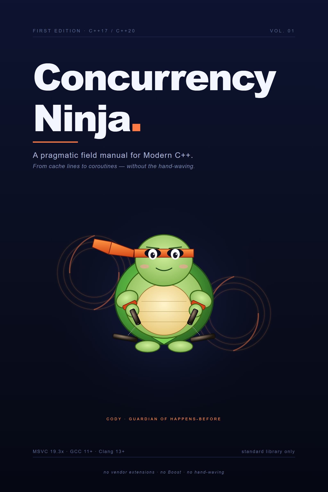

# Concurrency Ninja

> A pragmatic field manual for Modern C++ concurrency (C++17 / C++20). Original. Code-first. No hand-waving.

[](https://p0w.github.io/concurrency-ninja/)
[](LICENSE-CC-BY-4.0)
[](LICENSE-MIT)
[](https://rust-lang.github.io/mdBook/)

<p align="center">
  
</p>

## What this is

Twelve chapters covering the entire C++17/C++20 concurrency surface, written code-first with a snarky-but-rigorous voice. Built for engineers who already know C++ and now need threading to stop being a coin-flip.

- **Foundations** — cache lines, reordering, the memory model, `volatile` vs `atomic`, happens-before, UB
- **Threads** — `std::thread`, `std::jthread`, RAII, stop tokens
- **Mutexes** — `mutex`, `shared_mutex`, `recursive_mutex`, `scoped_lock` deadlock-free locking
- **`condition_variable`** — predicate form, spurious wakeups, lost wakeups, stop-token integration
- **`call_once` / `once_flag`** — initialization patterns, Meyers singleton, the DCLP trap
- **`std::atomic` & the memory model** — every `memory_order`, CAS, atomic-flag, atomic-ref, atomic-shared-ptr, wait/notify, fences
- **Futures** — `async` / `future` / `promise` / `packaged_task` / `shared_future`, the discarded-future footgun
- **C++20 sync** — `latch`, `barrier`, `counting_semaphore`, `binary_semaphore`
- **Cooperative cancellation** — `stop_source` / `stop_token` / `stop_callback`, `cv_any` overload
- **TLS & false sharing** — `thread_local`, cache-line padding, sharded counters
- **Production patterns** — SPSC ring, ThreadPool, atomic-shared-ptr publish, pipeline with back-pressure, TTL cache, MPMC queue, observable history list, sharded counter, `then()` composition
- **Pitfalls catalog** — broken/fixed pairs across the entire book's surface

Every primitive comes with a real-world intuition pump (the "Notebook Analogy" for false sharing, "Coat-check ticket" for futures, "Bouncer at a one-night club" for `call_once`, etc.), a production-grade snippet that compiles on **MSVC 19.3x / GCC 11+ / Clang 13+ with `-std=c++20`**, and a pitfalls section showing how to break it.

## Who it's for

Engineers who can already read C++ but want to stop guessing about threading. Not a language tutorial. Not CLRS. Interview-relevant for systems roles, but written for production engineers.

## Read it

**[p0w.github.io/concurrency-ninja](https://p0w.github.io/concurrency-ninja/)** — full book, with search, dark mode, deep links, copyable code.

A polished `.docx` is also available in [Releases](https://github.com/P0W/concurrency-ninja/releases) for offline reading.

## Build locally

```bash
cargo install mdbook
mdbook serve --open
```

That's it. No `npm install`, no Docker.

## Contributing

Errata, clearer analogies, missing edge cases, better pattern variations — all welcome.

1. Open an issue describing what's wrong / what's missing.
2. PR against `main`. CI builds the book and runs link-check on every PR.
3. By submitting, you agree your contribution is licensed under the same dual license as the rest of the book.

## License

Dual-licensed:

- **Prose** (chapters, intuitions, explanations) — [Creative Commons Attribution 4.0 International (CC BY 4.0)](LICENSE-CC-BY-4.0)
- **Code samples** (snippets, build scripts) — [MIT](LICENSE-MIT)
- **Cover art** (Cody the Concurrency Turtle in `assets/`) — CC BY 4.0, same as the prose

Use the code in proprietary projects with attribution. Share/remix the prose with attribution. No restrictions on either beyond that.

## Acknowledgements

Inspired in style by the [Rust Book](https://doc.rust-lang.org/book/) and [Crafting Interpreters](https://craftinginterpreters.com/). Built on [mdBook](https://rust-lang.github.io/mdBook/).
